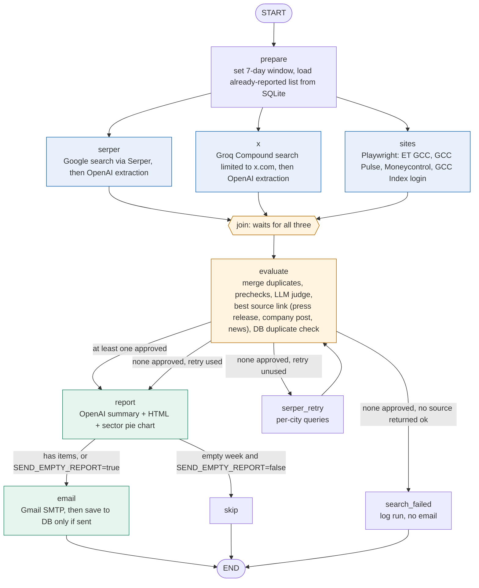
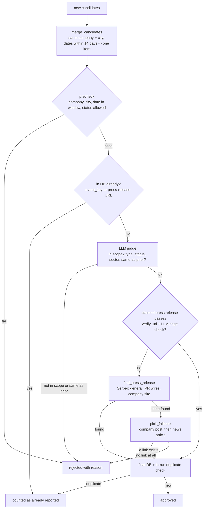
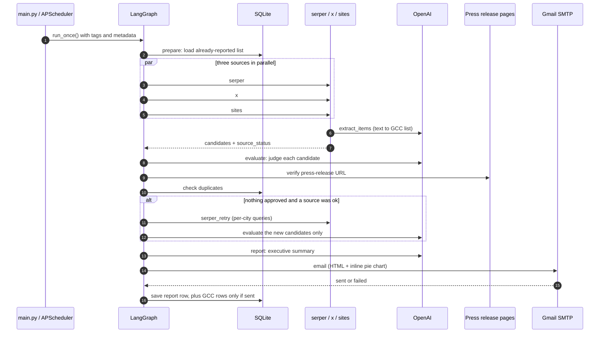
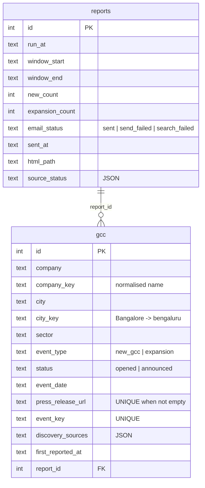

# Architecture and code walkthrough

## 1. The big picture

One LangGraph `StateGraph` (`gcc_agents/graph.py`). Every "agent" is either a graph node or a module a node calls.
Data flows through a single shared **state** dict; nodes return partial updates and LangGraph merges them.



LangGraph's own auto-generated version of this graph is in [`graph.auto.mmd`](graph.auto.mmd)
(regenerate with `python main.py --graph`). It shows the same nodes and edges; the diagram above adds the
routing conditions.

### Reading the routing

| After node | Condition (function in `graph.py`) | Goes to |
|---|---|---|
| `evaluate` | `state["approved"]` is non-empty | `report` |
| `evaluate` | nothing approved and **no** source status starts with `ok` | `search_failed` |
| `evaluate` | nothing approved, `attempts < 1`, Serper enabled and keyed | `serper_retry` |
| `evaluate` | nothing approved, retry already used | `report` (renders the empty-week email) |
| `report` | items exist, or `SEND_EMPTY_REPORT=true` | `email` |
| `report` | no items and `SEND_EMPTY_REPORT=false` | `skip` |

Why `search_failed` exists: "no new GCCs" is a factual claim. If every source errored out we cannot make it, so the
run is recorded as `search_failed` and nothing is emailed.

## 2. Shared state

Defined as `State` in `graph.py`. Fields with a reducer are **appended/merged** when several nodes write in the same
step; plain fields are overwritten.

| Field | Reducer | Written by | Meaning |
|---|---|---|---|
| `today`, `window_start`, `window_end` | overwrite | `prepare` | the 7-day window |
| `reported` | overwrite | `prepare` | "Company (City, type)" strings already in the DB, passed to extraction prompts |
| `candidates` | `operator.add` | `serper`, `x`, `sites`, `serper_retry` | raw `GCC` items from all sources |
| `processed` | overwrite | `prepare`, `evaluate` | how many candidates were already evaluated (so a retry only evaluates new ones) |
| `approved` | `operator.add` | `evaluate` | items that passed every criterion |
| `rejected` | `operator.add` | `evaluate` | `{company, city, reason, sources}` for the log |
| `already_reported_count` | `operator.add` | `evaluate` | duplicates skipped (shown in the email footer) |
| `source_status` | dict merge | every source node | `{"serper": "ok: ...", "moneycontrol": "blocked: ..."}` |
| `attempts` | overwrite | `prepare`, `serper_retry` | retry counter |
| `report` | overwrite | `report` | `Report(subject, html, text, chart_png, chart_cid)` |
| `outcome` | overwrite | terminal nodes | `sent`, `send_failed`, `dry_run`, `nothing_to_send`, `search_failed` |

The parallel fan-out (`serper`, `x`, `sites` all run at once) is why `candidates` and `source_status` need reducers:
without them the three nodes would overwrite each other.

## 3. What each piece of code does

```
main.py                     CLI: --once, --schedule, --list, --stats, --export-csv, --graph, ...
gcc_agents/
  config.py                 Settings from .env (never logged)
  tracing.py                LangSmith helpers (trace_tool, map_in_context, init_tracing)
  models.py                 ExtractedItem (LLM schema) -> GCC (domain model) + dedupe key normalisation
  llm.py                    ChatOpenAI factory + extract_items() structured extraction
  serper_source.py          "serper" node logic
  x_source.py               "x" node logic
  sites_source.py + sites/  "sites" node logic; one adapter per website
  evaluate_agent.py         "evaluate" node logic
  report_agent.py           "report" node logic (+ templates/report.html.j2)
  email_agent.py            SMTP sending
  db.py                     SQLite schema and queries
  graph.py                  builds the StateGraph, defines nodes and routing
```

### Sources (parallel)
- **`serper_source.run`** runs about 10 Google queries (6 general + 4 `site:` queries for the GCC sites) in a thread
  pool, each as both a web search and a news search restricted to the past week (`tbs=qdr:w`, India). Results are
  formatted as title / source / date / snippet / link and sent to `extract_items` in chunks of 30. On the retry
  (`attempt=1`) it instead runs one query per Indian city.
- **`x_source.run`** makes one Groq Compound call with `search_settings={"include_domains": ["x.com","twitter.com"]}`,
  then hands the answer plus raw search hits to `extract_items`. X posts are only leads: they go through the same
  evaluate checks as everything else.
- **`sites_source.run`** opens one headless Chromium, and for each enabled site calls `adapter.fetch(...)`:
  - `et_gcc`: reads the news listing, keeps event-like titles (open/launch/expand...), opens each article and reads
    `datePublished` and body from its JSON-LD.
  - `gcc_pulse`: the list is JavaScript-rendered; parses `#news-results > .news-day > .news-item` directly.
  - `moneycontrol`: blocked by bot protection ("Access Denied"); raises `SiteBlocked`, and Serper's `site:` query covers it.
  - `gccindex`: logs in with the credentials from `.env`, caches the session in `data/gccindex_state.json`, and
    captures the page text plus JSON responses.
  Each site is wrapped in its own try/except, so one failing site only sets its own status.
- **`llm.extract_items`** is the shared structured-extraction step: text in, `list[GCC]` out, tagged with the source name.
  The system prompt forbids inventing facts and rejects rumours, hiring news, appointments and so on.

### Evaluate (`evaluate_agent.run`)

The link shown in the email is chosen in this order, and its kind is stored as `source_kind`:
1. **`press_release`**: an official page that passes `verify_url` (official domain, not a careers/contact/locations
   page, mentions the company and the city or India) **and** `confirm_announcement` (an LLM confirms the page
   itself reports this event). A blocked page (403) is accepted only on a PR wire/government host or when the
   URL looks like a specific article, never for an index like `/media-centre/announcements`.
2. **`company_post`**: a post on the company's own LinkedIn or X account (the account name must contain the
   company name, so a third party's post about the company does not count).
3. **`news`** (or `post`): the article that reported the event, else a search hit about the company.

An item is not rejected for lacking an official press release, only if it has no source link at all.
Relevance and currency are still enforced by the date window, the India-GCC judge and the duplicate check.

### Report and email
- `report_agent.build` writes a 2 to 3 sentence summary with OpenAI (falls back to a fixed sentence on error),
  renders `report.html.j2` (autoescaped), builds a plain-text alternative, and draws the sector pie with matplotlib.
- `email_agent.build_message` makes a `multipart/related` message; the chart is attached inline and referenced as
  `cid:sector_pie`. `send` retries once and never raises.
- The `email` node saves to the DB **only if the send succeeded**. That ordering is what guarantees a failed
  send never marks items as "already reported".

## 4. One run, in sequence



## 5. Database


`event_key` is the "never repeat" guarantee:
`company_key|city_key|new_gcc` (a GCC is new once, ever) or `company_key|city_key|expansion|YYYY-MM`.

## 6. LangSmith tracing

Turn it on in `.env`:
```
LANGSMITH_TRACING=true
LANGSMITH_API_KEY=<your key>
LANGSMITH_PROJECT=gcc-india-weekly
```
Startup logs `LangSmith tracing: enabled: project=...` (or why it is off). LangChain and LangGraph calls are traced
automatically. Everything that is not a LangChain call (Serper, Groq, page scraping, URL checks, SMTP) is marked with
`@trace_tool(...)` in `tracing.py`, so a trace looks like this:

```
gcc_weekly_run                       tags: gcc-india, live|dry-run   metadata: sources, models, lookback_days
├─ prepare
├─ serper
│   ├─ google_serper_search x10      (query only, no keys)
│   └─ extract_items -> ChatOpenAI structured output
├─ x
│   ├─ groq_compound_x_search        (llm span)
│   └─ extract_items -> ChatOpenAI
├─ sites
│   ├─ scrape_site (site = et_gcc | gcc_pulse | moneycontrol | gccindex)
│   └─ extract_items -> ChatOpenAI
├─ evaluate
│   ├─ ChatOpenAI judge x N
│   ├─ verify_press_release_url
│   └─ find_press_release -> verify_press_release_url
├─ report -> ChatOpenAI summary
└─ email -> send_email               (subject only)
```

Two safeguards are built in and covered by `tests/test_tracing.py`:
- **No secrets in spans.** `trace_tool` strips any argument named `settings`, `browser`, `context`, `conn` or `page`
  (Settings holds every API key and the Gmail password).
- **Worker threads stay attached to their trace.** `map_in_context` copies contextvars into thread-pool tasks;
  with a plain `pool.map` the Serper and judge spans would vanish or appear as unrelated traces.

Privacy note: traces include the text sent to the LLM. That covers scraped article text and, when GCC Index is
enabled, the page content from your logged-in session. Set `LANGSMITH_HIDE_INPUTS=true` and/or
`LANGSMITH_HIDE_OUTPUTS=true` if you do not want that stored in LangSmith.

## 7. Where to change things

| I want to... | Edit |
|---|---|
| add a news source | new adapter in `sites/` (`fetch(context, settings, today) -> list[Doc]`), register in `sites_source.ADAPTERS` and `config.ALL_SOURCES` |
| change what counts as a GCC event | `EXTRACT_SYSTEM` in `llm.py` and `JUDGE_SYSTEM` in `evaluate_agent.py` |
| change dedupe rules | `GCC.event_key` in `models.py` (and the unique index in `db.py`) |
| change the email look | `templates/report.html.j2`, chart in `report_agent.sector_pie` |
| change the retry behaviour | `MAX_RETRIES` and `route_after_evaluate` in `graph.py` |
| change schedule | `--interval-min` / `--cron` in `main.py` |
