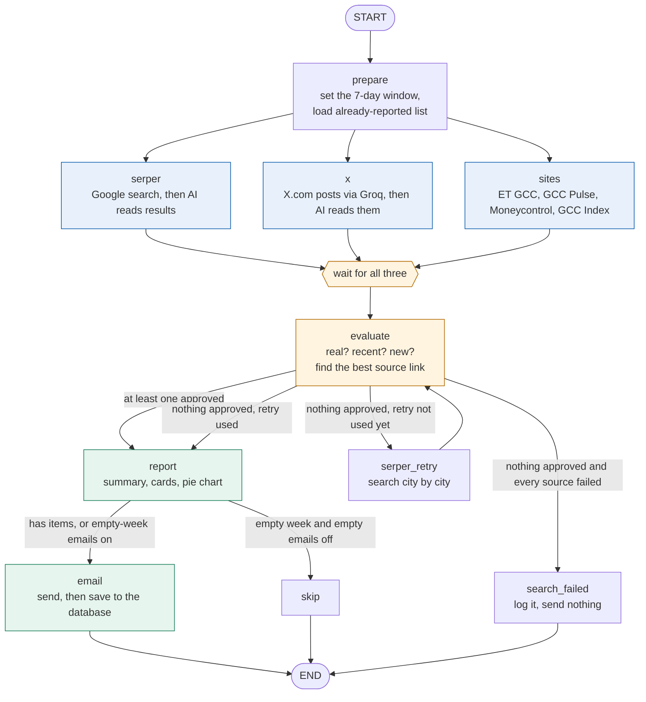
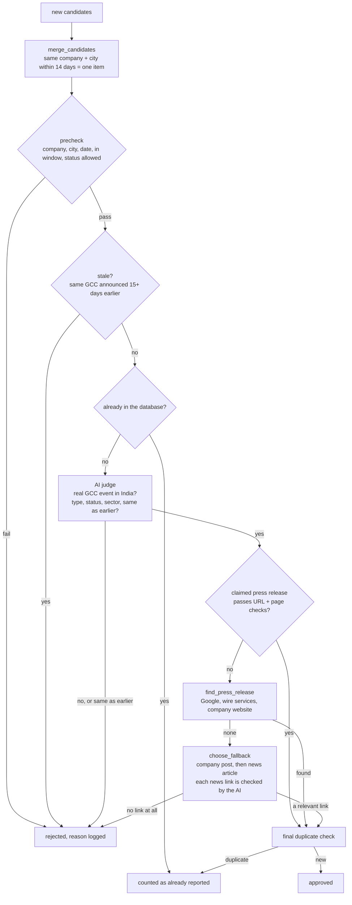

# GCC India Weekly — the complete code walkthrough

*A single document to read from start to finish. No prior knowledge of LangGraph, scraping or LLMs is assumed.*

**How to read this:** Parts 1–3 give you the whole picture in about 10 minutes. Parts 4–6 walk through every file.
Parts 7–11 cover rules, data, tests, commands and troubleshooting. If you only read one thing, read Parts 1, 2 and 3.

---

## Contents

1. [What this project does](#1-what-this-project-does)
2. [The big picture](#2-the-big-picture)
3. [One run, start to finish (with a real example)](#3-one-run-start-to-finish-with-a-real-example)
4. [Ideas you need first (plain-English glossary)](#4-ideas-you-need-first)
5. [Project map: every file in one line](#5-project-map)
6. [File-by-file walkthrough](#6-file-by-file-walkthrough)
7. [The rules the system follows (and why)](#7-the-rules-the-system-follows)
8. [The database](#8-the-database)
9. [Configuration (`.env`) and commands](#9-configuration-and-commands)
10. [Tests](#10-tests)
11. [Limits, troubleshooting and what to do next](#11-limits-troubleshooting-and-next-steps)

---

## 1. What this project does

Every week it answers one question:

> **"Which companies opened a new Global Capability Centre (GCC) in India, or expanded an existing one, in the last 7 days?"**

A **GCC** is an India-based centre that a multinational company runs for itself (technology, finance, engineering work).
Analysts track them because a new one means jobs and investment.

The program:

1. **Searches** several places for news (Google, X/Twitter, four GCC news sites).
2. **Reads** the results with an AI model and turns messy text into tidy records (company, city, date, type...).
3. **Checks** each record: is it real, recent, in India, not a rumour, not already reported?
4. **Finds a source link** for each one (press release if it exists, otherwise the company's own post, otherwise a news article).
5. **Builds an email** (cards + a sector pie chart) and **sends it to your Gmail**.
6. **Remembers** everything in a small database so the same GCC is never reported twice.

If nothing new is found, it sends a short "no new GCC activity this week" email instead.
If every source is broken, it sends nothing (so it never falsely says "nothing happened").

**Size:** about 2,200 lines of Python plus about 780 lines of tests (59 tests).

---

## 2. The big picture

Think of it as a small newsroom with five roles. Each role is a piece of code:

| Role | Job | Where it lives |
|---|---|---|
| **Search agent** | Go and find candidate news | `serper_source.py`, `x_source.py`, `sites_source.py` |
| **Source layer** | The places searched | Google (via Serper), X.com (via Groq), ET GCC, GCC Pulse, Moneycontrol, GCC Index |
| **Evaluate agent** | Decide what is real, recent and new, and pick the source link | `evaluate_agent.py` |
| **Report agent** | Write the email and draw the pie chart | `report_agent.py` + `templates/report.html.j2` |
| **Email agent** | Send it, and only then save to the database | `email_agent.py` + `graph.py` |

They are wired together by **LangGraph** in `graph.py`. LangGraph is a library that lets you draw a flowchart in code
("do A, then B and C at the same time, then D, and depending on the result go to E or F") and then runs it.



Two design ideas make the whole thing trustworthy, and you will see them repeated:

- **"Never lie by silence."** If every source failed, the program refuses to say "nothing new". It logs an error and stops.
- **"Save only after sending."** The database is updated only after Gmail accepted the email. If sending fails, nothing is
  marked as reported, so next time the same items are tried again.

---

## 3. One run, start to finish (with a real example)

Let's follow one real event: **Woodside Energy opens a GCC in Bengaluru (16 Sep 2026).** Command: `python main.py --once`.

| Step | What happens | Code |
|---|---|---|
| 1 | `main.py` reads your settings from `.env`, starts logging, turns LangSmith tracing on or off, and calls `run_once()`. | `main.py`, `config.py`, `tracing.py` |
| 2 | **prepare:** today is 20 Sep, so the window is 13–20 Sep. It loads the list of companies already in the database (so the AI is told not to return them). | `graph.py` |
| 3 | **Three sources run at the same time.** | `graph.py` |
| 3a | *Google:* about 10 searches such as "GCC India opens new global capability centre", each as a web search and a news search limited to the last week. About 80–100 results come back. | `serper_source.py` |
| 3b | *X.com:* one question to Groq's search model, limited to x.com. This week it found nothing. | `x_source.py` |
| 3c | *Sites:* one hidden Chrome browser visits ET GCC, GCC Pulse, Moneycontrol and (with your login) GCC Index. | `sites_source.py`, `sites/*` |
| 4 | An AI model reads each blob of text and outputs records like `{company: "Woodside Energy", city: "Bengaluru", type: new_gcc, date: 2026-09-16, summary: "..."}`. GCC Index is already structured, so no AI is needed there. | `llm.py`, `models.py` |
| 5 | All records are pooled (say 120 candidates, most from GCC Index's older rows). | `graph.py` |
| 6 | **evaluate:** merge duplicates (ET, GCC Pulse and GCC Index all mention Woodside: they become one record). Then quick rule checks: has a city? has a date? inside the window? Old GCC Index rows drop out here for free. | `evaluate_agent.py` |
| 7 | Is it "stale"? Is it already in the database? Not for Woodside. | `evaluate_agent.py`, `db.py` |
| 8 | A stronger AI model judges: real GCC event in India, not a rumour or hiring news? Sets the final type, opened/announced status and sector. | `evaluate_agent.py` |
| 9 | **Find the source link.** Look for an official press release (Google, wire services, the company site). None was found for Woodside. Fall back: the ET GCC article that reported it. The AI reads that page to confirm it is really about Woodside in Bengaluru. Label: **News**. | `evaluate_agent.py` |
| 10 | Woodside is **approved**. Six items were approved this week in total. | `graph.py` |
| 11 | **report:** an AI writes a 2–3 sentence summary; matplotlib draws the sector pie; a template builds the HTML email with one card per company. | `report_agent.py` |
| 12 | **email:** sent through Gmail. Gmail said yes, so the six items are saved in the database and a copy of the email is stored in `data/reports/`. | `email_agent.py`, `graph.py`, `db.py` |
| 13 | **Next week:** Woodside is found again, but the database says "already reported", so it is skipped. | `db.py` |

The whole run takes about 1.5–2 minutes and makes a modest number of AI and search calls.

---

## 4. Ideas you need first

You can skip this and come back when a word is unfamiliar.

| Term | Plain meaning |
|---|---|
| **LLM / AI model** | A program (here OpenAI's GPT) that reads text and answers questions about it. We use it as a careful reader, never as a source of facts. |
| **Structured output** | Instead of chatting, the AI is forced to fill in a form (a Python class), so we get clean fields, not paragraphs. |
| **Prompt** | The instructions and text we hand the AI. The main ones live in `llm.py` and `evaluate_agent.py`. |
| **LangChain / LangGraph** | Libraries for calling AI models (LangChain) and for wiring steps into a flowchart that runs (LangGraph). |
| **Node** | One box in the flowchart. In code, a Python function that receives the state and returns changes. |
| **State** | One shared notebook that all nodes read and write (`State` in `graph.py`). |
| **Reducer** | The rule for what happens when several nodes write the same field at the same time. `operator.add` means "append to the list". Without it, parallel sources would overwrite each other. |
| **Conditional edge** | An arrow that picks its destination by running a small function (for example "did evaluate approve anything?"). |
| **Serper** | A paid API that returns Google search results as data. |
| **Groq** | An AI service with a built-in web search that can be limited to certain sites. We limit it to x.com. |
| **Playwright** | A tool that drives a real, invisible Chrome browser. Needed for pages that build themselves with JavaScript, or need a login. |
| **JSON-LD** | Hidden structured data many news pages carry, including the publish date. We read it instead of guessing. |
| **SQLite** | A database that is a single file (`data/gcc.db`). No server needed. |
| **Dry run** | A full run that sends no email and writes nothing to the database. It writes `data/preview.html` instead. |
| **SMTP / app password** | The way programs send Gmail. Google requires a special 16-letter "app password", not your normal password. |
| **CID image** | How an image is embedded inside an email so it shows without a download link. |
| **LangSmith** | A website that records a "flight recording" of each run so you can inspect every step. Optional. |
| **APScheduler** | A Python timer used to run the job every N minutes or weekly. |

---

## 5. Project map

```
gccreport/
├── main.py                       Entry point: all commands (--once, --schedule, --list, --resend-last ...)
├── requirements.txt              Python packages needed
├── .env.example                  Template for your keys (the real .env is never committed)
├── gcc_agents/
│   ├── config.py                 Reads .env into a Settings object
│   ├── tracing.py                LangSmith helpers (and keeps keys out of traces)
│   ├── models.py                 The data shapes (GCC record) and the rules that make duplicates match
│   ├── dates.py                  Understands "2 days ago", "Sep 18, 2026"
│   ├── llm.py                    Creates the AI model; the shared "text to records" extractor
│   ├── serper_source.py          Source 1: Google search
│   ├── x_source.py               Source 2: X.com via Groq
│   ├── sites_source.py           Source 3: runs the four site adapters
│   ├── sites/
│   │   ├── base.py               Shared helpers for the adapters
│   │   ├── et_gcc.py             ET GCC news
│   │   ├── gcc_pulse.py          GCC Pulse news
│   │   ├── moneycontrol.py       Moneycontrol (blocked; stub that reports "blocked")
│   │   └── gccindex.py           GCC Index events (login, structured feed)
│   ├── evaluate_agent.py         The judge: filters, verifies, picks the source link
│   ├── report_agent.py           Builds subject, HTML, text and the pie chart
│   ├── templates/report.html.j2  The email layout (mobile-friendly cards)
│   ├── email_agent.py            Sends through Gmail
│   ├── db.py                     SQLite: save, look up, list, export
│   └── graph.py                  The flowchart itself
├── tests/                        59 automated tests
└── docs/                         Architecture doc, graph, and this walkthrough
```

Lines of code (approx.): `evaluate_agent` 500, `db` 227, `graph` 194, `main` 174, `models` 165, `gccindex` 137, `report_agent` 130,
`serper_source` 95, `sites_source` 80, everything else under 75 each.

---

## 6. File-by-file walkthrough

### 6.1 `config.py` — settings (50 lines)

**Purpose:** turn the `.env` file into one `Settings` object that the rest of the code passes around.

- `load_dotenv(ROOT / ".env")` copies every line of `.env` into the environment when the file is imported.
- `Settings` is a Python *dataclass*. Each field reads one variable: `openai_model`, `judge_model`, `serper_key`, `groq_key`,
  `gccindex_user/pass`, `gmail_user/password`, `to_email`, `lookback_days` (7), `send_empty_report` (True),
  `include_announced` (True), `disabled_sources`.
- **Safety detail:** all secrets are declared with `repr=False`. If a Settings object is ever printed (in an error message or a
  failing test), the keys do **not** appear. This was added after a test failure once printed part of a key.
- `source_enabled(name)` answers "should this source run?": respects `--only` (run just these) and `DISABLED_SOURCES`.
- Also defines the file paths: `data/gcc.db`, `data/reports/`, `data/gccindex_state.json`.
- `ALL_SOURCES = serper, groq_x, et_gcc, gcc_pulse, moneycontrol, gccindex`.

### 6.2 `models.py` — the shapes of the data (165 lines)

**Purpose:** define what a "GCC record" is, and the rules that decide when two records are "the same".

**Three classes:**

- `ExtractedItem` is the form the AI fills in. Everything is plain text (dates as `"2026-09-16"`), because AI models are
  most reliable with plain text. Its field descriptions double as instructions to the AI.
- `ExtractionResult` is just `{ items: [ExtractedItem, ...] }`.
- `GCC` is the real record used everywhere: `company`, `city`, `state`, `sector`, `event_type` (`new_gcc` or `expansion`),
  `status` (`opened` or `announced`), `event_date`, `headcount`, `summary`, `press_release_url` (a *claimed* official link),
  `source_urls`, `discovery_sources` (which sources found it), and the two fields chosen later: `source_url` and `source_kind`
  (`press_release`, `company_post`, `news`, `post`).
  `GCC.from_extracted()` converts the AI's text into this cleaner form (parsing the date, trimming spaces).

**Properties that make deduplication work:**

| Property | Example | Why |
|---|---|---|
| `company_key` | "Acme India Pvt Ltd" → `acme` | strips words like Pvt, Ltd, Inc, India, GCC, so spelling differences don't matter |
| `city_key` | "Bangalore, Karnataka" → `bengaluru` | maps old and alternate names (Gurgaon → Gurugram, Bombay → Mumbai) |
| `event_key` | `woodside energy\|bengaluru\|new_gcc` | the identity of an event. For expansions it adds the month, so a later expansion can appear |
| `source_label` | "News", "Company post", "Press release", "Post" | text shown on the link in the email |
| `source_host` | `thehindu.com` | short site name shown in small grey text under the link |

Also: `SECTORS` (the 7 allowed sector names) and `canonical_url()` (removes tracking bits like `?utm_source=` and `www.`).

### 6.3 `dates.py` — reading messy dates (30 lines)

Google results say "2 days ago", "5 hours ago" or "Sep 18, 2026". `parse_web_date(text, today)` turns these into real dates:

- "N minutes/hours ago" → today; "N days ago" → today minus N; "N weeks ago" → minus 7N.
- ISO timestamps and common text formats work too. Anything it cannot understand returns `None` (never a guess).

This matters: before this file existed, about 10 of 17 candidates in a test run were thrown away for having "no event date".

### 6.4 `llm.py` — the AI reader (63 lines)

**`chat(settings, judge=False)`** builds an OpenAI chat model. Normal work uses `OPENAI_MODEL` (cheaper, default `gpt-4o-mini`);
judging uses `OPENAI_JUDGE_MODEL` (stronger, default `gpt-4o`). Temperature 0 = as consistent as possible.

**`extract_items(settings, text, source, today, already_reported, default_date)`** is the workhorse used by every source:

1. Gives the AI a strict instruction (`EXTRACT_SYSTEM`): only real GCC openings or expansions in India; use **only** facts in
   the text; never invent dates, cities or URLs; skip rumours, hiring news, appointments, ordinary IT-services offices;
   use the "Published:" date when the text has no better date.
2. Adds today's date, the "already reported" list (do not return these) and the text (up to 24,000 characters).
3. Forces the answer into the `ExtractionResult` form.
4. Tags each result with the source name and returns a list of `GCC` records.

**`fill_missing_dates(items, default_date)`**: if the AI left a date empty but we know the page's publish date, use it.

### 6.5 `tracing.py` — LangSmith and secret safety (58 lines)

LangChain and LangGraph calls are traced automatically when `LANGSMITH_TRACING=true`. This file covers what they cannot see:

- `trace_tool(name)` is a decorator that also records non-AI steps (Serper calls, URL checks, sending the email) as spans.
  It uses `scrub_inputs`, which removes anything named `settings`, `browser`, `context`, `conn` or `page` **before** it is
  recorded, so API keys never reach LangSmith.
- `map_in_context(pool, fn, items)` is like `pool.map` for thread pools but copies the "current trace" into each worker thread.
  Without it, work done in threads would show up as disconnected traces.
- `init_tracing()` runs at startup and logs "enabled: project=..." or the reason it is off (for example, a missing key).

### 6.6 `db.py` — the memory (227 lines)

**Purpose:** everything that touches `data/gcc.db`. Details of the tables are in [Part 8](#8-the-database).

| Function | What it does |
|---|---|
| `connect()` | Context manager: opens the file, creates tables if missing, runs `_migrate`, commits at the end (or rolls back on error) |
| `_migrate()` | Upgrades an older database by adding the `source_url` and `source_kind` columns |
| `is_duplicate(conn, item)` | True if the `event_key` exists, or the official press-release URL exists |
| `prior_for_company(conn, company)` | Earlier events for a company; shown to the judge so it can spot "same event, different words" |
| `reported_summary(conn)` | List of `"Company (City, type)"` strings given to the AI as an exclusion list |
| `save_report(...)` | Inserts one row into `reports` and one row per item into `gcc`. A duplicate that slips through is silently skipped by the database's UNIQUE rules |
| `load_report(conn, id)` | Rebuilds a saved report's items as `GCC` objects (used by `--resend-last`) |
| `list_items`, `stats`, `export_csv` | Query the year's data: filter by year, sector, city, type; counts by type/sector/city/month; CSV export |
| `reset(conn)` | Empties both tables (testing) |

### 6.7 `serper_source.py` — Google search (95 lines)

**Purpose:** ask Google what happened this week and pass the results to the AI.

- **Queries.** 6 general ones ("GCC India opens new global capability centre", "GCC expansion India new facility seats"...)
  plus 4 `site:` queries, one per GCC news site. Each query runs twice: as a normal web search and as a news search, both limited
  to the past week (`tbs=qdr:w`), country India.
- **Speed.** Up to 6 queries run in parallel threads (`map_in_context` keeps tracing connected).
- **Formatting.** `_format` removes duplicate links and turns each hit into three lines: title | source | *Published: 2026-09-18*,
  the snippet, and the link. Dates come from `parse_web_date`.
- **Reading.** Results go to `extract_items` in chunks of 30 hits.
- **Retry mode (`attempt=1`).** If the first pass approves nothing, it runs one query per city (15 Indian cities) instead.
- **Failure handling.** Everything is inside `try/except`. On error it returns no candidates and a status like
  `failed: ...`. One broken source must never crash the run.

### 6.8 `x_source.py` — X.com through Groq (48 lines)

- One call to Groq's search model, told to search **only** x.com/twitter.com, for posts in the last 7 days about a company opening
  or expanding a GCC in India.
- The answer plus the raw search hits are passed to `extract_items`, tagged `groq_x`.
- X posts are only *leads*: they go through exactly the same checks as everything else.
- Honest note: so far it found nothing, because X is mostly behind a login wall. If it stays empty, it costs money and adds no value.

### 6.9 The site adapters (`sites/`)

Each adapter has one function, `fetch(...)`, that returns a list of `Doc` objects (`url`, `text`, `published` date, and
optionally ready-made `items`).

**`sites/base.py` — shared helpers**

- `USER_AGENT`: how our browser introduces itself.
- `EVENT_TITLE`: a pattern (open, launch, inaugurate, expand, "set up", unveil...). Used to skip trend pieces and
  interviews before spending time on them.
- `SiteBlocked` and `SiteSkipped`: two "expected" problems (bot protection; missing credentials).
- `Doc`: the result container. `in_window()` checks a date is inside the window (±1 day of slack).
- `parse_any_date()`, `chunk_docs()`: small helpers.

**`sites/et_gcc.py` — Economic Times GCC**

1. Loads the news listing page in Chrome.
2. `parse_listing()` keeps only article links (pattern `/news/<category>/<slug>/<number>`) whose *title* looks like an event, up to 25.
3. Opens each article and reads `datePublished` and body text from its JSON-LD (`parse_article_ld`).
4. Keeps only articles inside the window.

**`sites/gcc_pulse.py` — GCC Pulse**

The list is built by JavaScript after the page loads, so a plain download would see an empty page. The adapter waits for
`#news-results .news-day`, then reads each day's date and each item's title and text. No article visits are needed.

**`sites/moneycontrol.py` — Moneycontrol**

The site answers with "Access Denied" to automated browsers. The adapter detects that and raises `SiteBlocked`. It deliberately does
**not** try to disguise the browser. Moneycontrol news still reaches the system indirectly through Serper's `site:moneycontrol.com` query.

**`sites/gccindex.py` — GCC Index (login)**

- Uses your `GCCINDEX_USERNAME/PASSWORD` **only** to fill the site's own login form. The logged-in session is saved to
  `data/gccindex_state.json` so it logs in only when the session expires.
- The events page loads its own data from an internal feed (`/events/data`) with exact dates. The adapter opens the page normally,
  lets the page make that request, and reads the response. It never calls the feed directly (the site forbids that).
- It selects "20 / page" using the page's own dropdown so one visit covers more than a week.
- `parse_events()` converts each JSON row into a `GCC` (exact `announcementDate`, `NEW_GCC` / `EXPANSION`, city, sector mapped
  to our 7 sectors, description as summary). **No AI is used here**: the data is already structured.
- It keeps rows up to about four months old. Evaluate rejects the old ones cheaply, and uses them to detect stale re-reports.
- Writes `data/gccindex_debug.txt` (local only) for troubleshooting.

### 6.10 `sites_source.py` — running the adapters (80 lines)

1. Starts **one** hidden Chrome for all sites.
2. For each enabled site: opens a fresh browser context (GCC Index manages its own), calls `_scrape(...)` (a traced wrapper around
   `adapter.fetch`).
3. For each returned `Doc`: if it has ready-made `items` (GCC Index) use them; otherwise send the document to `extract_items`
   **one document at a time**, so each result inherits its own publish date if the AI left it blank.
4. Records a status per site: `ok: 5 docs, 4 candidates`, `skipped: ...`, `blocked: ...` or `failed: ...`.
   Each site is wrapped separately, so one failing site does not affect the others.

### 6.11 `evaluate_agent.py` — the judge (500 lines, the most important file)

This decides what reaches the email. It runs in a strict order so cheap checks come before expensive ones.



**Step 1: `merge_candidates`.** Three sources may report the same event. Records with the same company key and city key, and dates
within 14 days, become one record (sources and links are combined, "opened" beats "announced"). Sources are ranked
(ET GCC first, then GCC Pulse, Serper, GCC Index, X, Moneycontrol) to decide which record leads.

**Step 2: `precheck`.** Pure rules, no AI: company name present; city present; a date present; date within the last 7 days (and
not more than a day in the future); status allowed (if `INCLUDE_ANNOUNCED` is off, only "opened").

**Step 3: stale check.** Some articles about an *old* event are published this week. If any candidate shows the same company and
city as a "new GCC" more than 14 days *earlier* (for example GCC Index lists it on 25 Aug), the late article is rejected as
"stale". Real example: Syneos Health in Hyderabad.

**Step 4: database check.** `db.is_duplicate` (see Part 7).

**Step 5: the AI judge (`_judge`, `Verdict`).** A stronger model receives the record plus earlier records for the same company.
It returns: `in_scope` (a genuine GCC event in India, not a rumour, hiring news, layoffs, appointment, conference, ordinary
IT-services office), `event_type`, `status`, `sector` (one of the 7), `same_as_prior`, and a one-line `reason`.

**Step 6: choose the source link.** In order of preference. Approval does **not** depend on finding an official press release.

| Preference | What it is | How it is checked |
|---|---|---|
| 1. **Press release** | An official page: PR wire, government site, or a domain that contains the company name | `verify_url`: not a careers, contact, about or locations page; fetchable; mentions the company; mentions the city or India; reads like an announcement. Then `confirm_announcement`: the AI reads the page and confirms it is *itself* the announcement. If the page blocks robots (403), it is accepted only on a PR wire/government host, or when the URL looks like a specific article (not an index such as `/media-centre/announcements`). |
| 2. **Company post** | A post on the company's *own* LinkedIn or X account | `is_company_post`: the account name in the URL must contain the company name. A third party's post about the company does not count. |
| 3. **News** (or Post) | The article that reported the event, or a search hit about the company | `news_is_relevant`: the page is fetched and the AI confirms it is about this event. If the page is unreadable (paywall), it is accepted only on strong hints in the URL or snippet (company name plus city or "GCC"). Junk sites (job boards, Glassdoor, GCC Index) are skipped. Only the first 4 news links are checked, to bound cost. |

`find_press_release` searches Google, then the PR wires (PR Newswire, Business Wire, GlobeNewswire), then discovers the company's
own website (`_company_domain`) and searches inside it. It gives up after a per-run budget (`MAX_RESOLVE_PER_RUN = 20`).
If none is found, an item is still approved with a company post or news link. It is rejected only if **no link at all** exists.

**Step 7: final duplicate check**, then approved. Judging runs in 4 parallel threads (`map_in_context`).

The function returns `(approved, rejected, already_reported_count)`. Every rejection carries a reason.

### 6.12 `report_agent.py` and `templates/report.html.j2` — the email (130 + 94 lines)

**`report_agent.build()`** returns a `Report(subject, html, text, chart_png, chart_cid)`:

- **Order:** new GCCs first, then expansions; oldest date first within each.
- **Subject:** `GCC India Weekly: 4 new GCCs, 2 expansions (13 Sep 2026 – 20 Sep 2026)`, or `... no new GCC activity (...)`.
- **Summary:** `executive_summary` asks the AI for 2–3 sentences using only the facts given. On any error it falls back to a fixed sentence.
- **Pie chart:** `sector_pie` draws with matplotlib in a headless mode, near-square with the legend underneath so it stays readable
  when a phone shrinks it. Returns PNG bytes.
- **Plain-text version:** for mail apps that do not show HTML. One block per item.

**The template** (Jinja2, with auto-escaping so text in a company name can never inject HTML):

- Header with the date range; summary paragraph; three counters (New GCCs, Expansions, Cities).
- **One card per company** (not a table). Each card has the name and a green *New GCC* / orange *Expansion* badge, the summary, then three
  labelled rows: *Location* (city, state, with the sector in grey below), *Date*, *Source* (the link labelled "Press release", "Company post" or "News",
  with the short site name beside it). A small "Announced" note appears only for items that are announced rather than opened.
- The pie chart, referenced as `cid:sector_pie`.
- A footer line only if some items were already reported earlier.
- **Why cards:** a five-column table overlapped on phones. Stacked cards cannot overlap at any width. The layout is fluid
  (`width:100%; max-width:720px`) and has a small `@media` tweak for narrow screens.

### 6.13 `email_agent.py` — sending (59 lines)

- `build_message` makes a `multipart/related` email containing a `multipart/alternative` (plain text and HTML) plus the chart as an
  inline image with `Content-ID: <sector_pie>`, so the HTML's `cid:sector_pie` shows it.
- `send` connects to `smtp.gmail.com:465` over SSL, logs in with your app password (spaces removed), sends, and **retries once**.
  It never raises an error: it returns `(True, "sent")` or `(False, reason)`, and the caller decides what to do.
- `missing_config` reports which of `GMAIL_USER`, `GMAIL_APP_PASSWORD`, `TO_EMAIL` are empty.

### 6.14 `graph.py` — the flowchart in code (194 lines)

`build_graph(settings, dry_run, today)` defines the nodes as small functions inside one function, so they can use `settings`:

| Node | What it does |
|---|---|
| `prepare` | Sets `today`, the window and the already-reported list; resets counters |
| `serper`, `x`, `sites` | Run each source; return `candidates` and a `source_status` |
| `serper_retry` | Runs Google again city-by-city; increments `attempts` |
| `evaluate` | Judges only the *new* candidates (`processed` remembers how many were done, so a retry does not re-judge). Logs a rejection line per rejected item, and one summary line for old items outside the window |
| `search_failed` | Records a `search_failed` row in `reports` (unless dry run) and ends |
| `report` | Calls `report_agent.build` |
| `skip` | Used when an empty week should not be emailed |
| `email` | Dry run: writes `data/preview.html` with the chart embedded. Real run: sends; only if it worked, saves the archive HTML and the items; if it failed, records `send_failed` **without** saving items |

**Routing functions:**

- `route_after_evaluate`: approved → `report`; else if no source status starts with "ok" → `search_failed`; else if the retry is unused
  and Serper is available → `serper_retry`; else → `report` (the empty-week email).
- `route_after_report`: no items and empty emails off → `skip`; otherwise → `email`.

**State fields** (the shared notebook): `candidates`, `approved`, `rejected`, `already_reported_count` (all appended by the reducer);
`source_status` (dictionaries merged); `processed`, `attempts`, `report`, `outcome` (overwritten).

`run_once` compiles the graph, attaches LangSmith tags and metadata (dry-run vs live, sources, models), runs it, logs the outcome and
returns the final state. Possible outcomes: `sent`, `send_failed`, `dry_run`, `nothing_to_send`, `search_failed`.

### 6.15 `main.py` — the command line (174 lines)

`main.py` reads the flags, sets up logging (console and `data/run.log`), and dispatches. Order of checks: `--graph`, then tracing
setup, `--only` validation, `--reset-db`, list/stats/export, `--resend-last`, `--schedule`, then `--once`/`--dry-run`.

- `safe_run` wraps every scheduled run in try/except so a crash is logged and the scheduler keeps going.
- `--schedule` uses APScheduler: default every 5 minutes (runs immediately, `max_instances=1`, `coalesce=True`), or `--cron "mon 09:00"`
  for weekly (`parse_cron` converts the text).
- `resend_last` rebuilds the last sent report from the database, renders it with the *current* template, and sends it again. It does not
  change the database. Used after layout changes.
- Exit code 2 when the outcome is `search_failed` (useful for schedulers and monitors).

---

## 7. The rules the system follows

| Rule | Where enforced | Why |
|---|---|---|
| **A "new GCC" is new only once, ever** | `event_key = company\|city\|new_gcc` is UNIQUE in the database | The same GCC must never be reported twice |
| **An expansion can repeat, but not the same story** | `event_key` includes the month for expansions | A genuinely later expansion is news; a re-run of the same one is not |
| **Same official press-release URL is unique** | partial UNIQUE index on `press_release_url` | Second safety net |
| **Old news is not new** | `stale:` check in `evaluate_agent.run` | Late articles about earlier events |
| **Only the last 7 days** | `precheck` | The report is weekly |
| **No rumours, hiring news, appointments, layoffs, conferences** | AI prompts in `llm.py` and `evaluate_agent.py` | Not GCC arrivals or expansions |
| **Every item has a source link, labelled honestly** | `evaluate_agent` + template | You can verify anything you read |
| **Don't invent facts** | Extraction prompt; summary prompt uses only given facts | AI models can hallucinate |
| **Never say "nothing new" if we could not look** | `search_failed` branch in `graph.py` | A false negative is worse than no email |
| **Never mark items reported unless the email was sent** | `email` node in `graph.py` | A failed send must not hide items |
| **One source failing must not stop the run** | try/except in every source; per-site status | Websites change or block |
| **Don't bypass bot protection or site rules** | Moneycontrol adapter; GCC Index never called directly | Respect the sites |
| **Keys never leave your machine** | `.gitignore`, `repr=False`, `scrub_inputs` | Security |

---

## 8. The database

File: `data/gcc.db` (SQLite). Created automatically. It is ignored by git.

**Table `reports`**: one row per run that reached the end.

| Column | Meaning |
|---|---|
| `id`, `run_at` | Which run and when |
| `window_start`, `window_end` | The 7 days covered |
| `new_count`, `expansion_count` | How many of each were sent |
| `email_status` | `sent`, `send_failed` or `search_failed` |
| `sent_at`, `html_path` | When it was sent; path of the saved copy |
| `source_status` | JSON of what each source did |

**Table `gcc`**: one row per reported event.

| Column | Meaning |
|---|---|
| `company`, `city`, `state`, `sector` | Who and where (plus normalised `company_key`, `city_key`) |
| `event_type` | `new_gcc` or `expansion` |
| `status` | `opened` or `announced` |
| `event_date`, `headcount`, `summary` | When, size, description |
| `source_url`, `source_kind` | The link shown in the email and its kind |
| `press_release_url` | Only filled when the source is a verified official release (unique when present) |
| `source_urls`, `discovery_sources` | JSON: all links seen and which sources found it |
| `event_key` | **UNIQUE**: the identity used to stop repeats |
| `first_reported_at`, `report_id` | When first reported, and in which report |

Every item ever reported stays in `gcc`, so you can ask year-round questions:
`python main.py --list --year 2026`, `--stats --year 2026`, `--export-csv gcc_2026.csv`.

---

## 9. Configuration and commands

### `.env` settings

| Setting | Required? | Purpose |
|---|---|---|
| `OPENAI_API_KEY` | Yes | All AI steps |
| `OPENAI_MODEL`, `OPENAI_JUDGE_MODEL` | No | Reader and judge models (defaults `gpt-4o-mini`, `gpt-4o`) |
| `SERPER_API_KEY` | Yes for Google | Google search |
| `GROQ_API_KEY`, `GROQ_MODEL` | Optional | X.com search |
| `GCCINDEX_USERNAME`, `GCCINDEX_PASSWORD` | Optional | GCC Index events |
| `GMAIL_USER`, `GMAIL_APP_PASSWORD`, `TO_EMAIL` | Yes to send | Sender, 16-letter app password, recipient |
| `LANGSMITH_TRACING`, `LANGSMITH_API_KEY`, `LANGSMITH_PROJECT` | Optional | Tracing |
| `LOOKBACK_DAYS` | No (7) | Window length |
| `SEND_EMPTY_REPORT` | No (true) | Email even when nothing is new |
| `INCLUDE_ANNOUNCED` | No (true) | Include announced (not only opened) items |
| `DISABLED_SOURCES` | No | e.g. `groq_x,gccindex` |

### Commands

```bash
python main.py --once --dry-run                    # full run, no email, writes data/preview.html
python main.py --once                              # real run: sends the email, records items
python main.py --once --dry-run --only et_gcc      # test one source
python main.py --resend-last [--dry-run]           # re-send the last report with the current layout
python main.py --schedule                          # every 5 minutes (testing)
python main.py --schedule --cron "mon 09:00"       # weekly
python main.py --list --year 2026                  # what has been reported
python main.py --list --sector BFSI --city Hyderabad --type expansion
python main.py --stats --year 2026                 # counts by type, sector, city, month
python main.py --export-csv gcc_2026.csv --year 2026
python main.py --graph                             # print the flowchart as Mermaid
python main.py --reset-db                          # wipe history (testing only)
python -m pytest -q                                # run the tests
```

---

## 10. Tests

59 tests, all offline: the internet, the AI and email are replaced by fakes, so they run in about 8 seconds and cost nothing.
`conftest.py` gives every test its own temporary database and **dummy** keys (never your real ones).

| File | Tests | What it proves |
|---|---|---|
| `test_dedupe.py` | 21 | Name/city/URL normalisation; merging; date rules; stale detection; official-domain rules; page verification; company-post detection; fallback ordering; date parsing |
| `test_db.py` | 7 | Duplicate detection; "new GCC unique forever, expansion can recur"; unique-constraint safety; empty-week rows; list/stats/CSV; reset; round trip of a saved report |
| `test_sites_parsing.py` | 7 | ET listing and JSON-LD parsing; GCC Pulse parsing; date helpers; GCC Index feed parsing (exact dates, window, no AI needed) |
| `test_report.py` | 5 | Email content and subject; empty week; HTML escaping; the mobile card layout; short site names |
| `test_email.py` | 5 | Message structure and inline image; success path; one retry then failure; missing settings |
| `test_graph_routing.py` | 11 | End to end with fakes: approve and send; repeat next week is skipped; retry then empty-week email; empty emails off; all sources failed sends nothing; one source failing still reports; failed send does not save items; dry run writes no database rows; fallbacks to news/company post; no link means rejection |
| `test_tracing.py` | 3 | Secrets stripped from traces; trace status messages; spans stay attached in threads |

---

## 11. Limits, troubleshooting and next steps

### Known limits (honest list)

- **Moneycontrol** is blocked by bot protection; it is covered only through Google's `site:` search.
- **X.com via Groq** has found nothing so far.
- **The AI can still be wrong.** Checks reduce this, but a weak news link can get through. Idea: require two independent sources
  when there is no press release or company post.
- **Dates:** if an article gives no event date, the article's publish date is used. Usually right, occasionally a day or two off.
- **News sites** occasionally block our page fetch; those links are accepted only on strong URL/snippet hints.
- **ET GCC** is read from its first listing page only (25 candidate articles).
- **GCC Index** access depends on your account and its terms of use; the page structure can change.
- **Nothing is scheduled yet.** The pieces exist (`--schedule --cron`), but it does not run by itself until you host it (PC task scheduler or a cloud VM).
- **No failure alerts yet:** a failed run is only visible in `data/run.log`.
- **One machine:** SQLite lives on one computer. A cloud host needs a persistent disk (or a switch to a server database).
- **Cost:** each run uses OpenAI, Serper and (if enabled) Groq calls. Weekly is cheap; a 5-minute test loop adds up.

### Troubleshooting

| You see | Meaning and fix |
|---|---|
| `SMTPAuthenticationError 535 ... Username and Password not accepted` | Not a real app password. It must be exactly 16 lowercase letters from https://myaccount.google.com/apppasswords (needs 2-Step Verification). |
| `outcome=search_failed` | Every source failed (keys, network, blocked). Nothing was emailed on purpose. Read `data/run.log` for each source's status. |
| `skipped: SERPER_API_KEY not set` (or GROQ, GCC Index) | The key is empty in `.env`. That source is skipped, others continue. |
| Every candidate rejected as "no event date" | The source gave no date. Check the source in `--only` mode. |
| `no source link found` | The item had no link at all anywhere. Rare. |
| `stale: this GCC was already announced on ...` | Working as intended: an old event in a fresh article. |
| `blocked: Access Denied` on Moneycontrol | Expected. |
| GCC Index `login failed` | Wrong username/password in `.env`; delete `data/gccindex_state.json` and retry. |
| You get a "no new GCC activity" email every 5 minutes | You are on the 5-minute test loop and everything is already reported. Set `SEND_EMPTY_REPORT=false` or switch to `--cron`. |
| Email layout looks old | Run `python main.py --resend-last` to rebuild it from the saved data. |
| `playwright` errors about a missing browser | Run `python -m playwright install chromium`. |

### Suggested next steps

1. **Host it** so it runs weekly without your PC (a free always-on VM, or Windows Task Scheduler as a first step).
2. **Failure alerts:** email or message yourself on `search_failed` / `send_failed`, plus a heartbeat check.
3. **Timezone and locking:** use India time explicitly, and prevent two runs overlapping.
4. **Extra proof for weak items** (two independent sources when there is no press release or company post).
5. **Decide on X/Groq** after a few weeks of results.
6. **Pin exact package versions** and add CI that runs the tests on every push.

---

*End of walkthrough. For the diagrams-only view see `docs/ARCHITECTURE.md`; for setup see `README.md`.*
