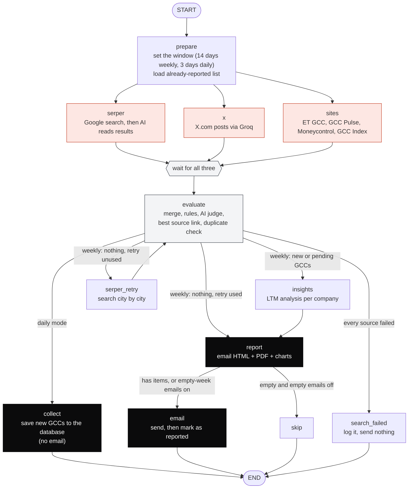
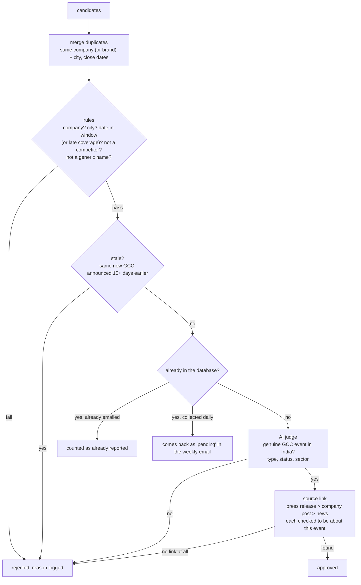

# India GCC Intelligence — the complete code walkthrough

*One document to read from start to finish. No prior knowledge of LangGraph, scraping or LLMs is assumed.*

**How to read this:** Parts 1–3 give the whole picture in about 10 minutes. Part 4 gets it running on your own
computer. Parts 5–8 walk through every file, including the dashboard. Parts 9–12 cover rules, data, tests and
troubleshooting. If you only read three things, read Parts 1, 2 and 4.

---

## Contents

1. [What this project does](#1-what-this-project-does)
2. [The big picture](#2-the-big-picture)
3. [One run, start to finish (with a real example)](#3-one-run-start-to-finish-with-a-real-example)
4. [Run it locally, step by step](#4-run-it-locally-step-by-step)
5. [Ideas you need first (plain-English glossary)](#5-ideas-you-need-first)
6. [Project map: every file in one line](#6-project-map)
7. [File-by-file walkthrough: the pipeline](#7-file-by-file-walkthrough-the-pipeline)
8. [The dashboard, the backfill and the daily refresh](#8-the-dashboard-the-backfill-and-the-daily-refresh)
9. [The rules the system follows (and why)](#9-the-rules-the-system-follows)
10. [The database](#10-the-database)
11. [Settings, commands and tests](#11-settings-commands-and-tests)
12. [Limits, troubleshooting and next steps](#12-limits-troubleshooting-and-next-steps)

---

## 1. What this project does

It answers one question for LTM's leadership, continuously:

> **"Which companies opened a new Global Capability Centre (GCC) in India, or expanded one — and where can
> LTM's GCC Origin business win work?"**

A **GCC** is an India-based centre a multinational runs for itself (technology, finance, engineering work). LTM's
**GCC Origin** unit (launched 28 Oct 2026) helps enterprises set up, run and transform GCCs, so every new GCC is a
potential client.

The system has four jobs:

| Job | When | What you get |
|---|---|---|
| **Daily refresh** | every day, 07:00 IST | New GCCs from the last few days are added to the database (no email) |
| **Weekly email** | e.g. Monday 09:00 | The **India GCC Report** email plus the **India GCC Weekly Intel Report** PDF |
| **Dashboard** | whenever you open it | A live LTM-themed web page: filter, search, analyse, download, email |
| **Backfill** | once (or per year) | The whole year's GCCs loaded into the database |

Every GCC goes through the same pipeline: **search** several sources → an AI **reads** the results into tidy
records → strict **checks** (real, recent, in India, a business, not a competitor, not a repeat) → a **source link**
→ an **LTM opportunity analysis** (business area, products, the India centre's mandate, how LTM wins) → stored in
a small database that never forgets what was already reported.

**Size:** about 3,900 lines of application code and 1,240 lines of tests (108 tests).

---

## 2. The big picture

Think of it as a small analyst team. Each role is a piece of code:

| Role | Job | Where it lives |
|---|---|---|
| **Search agents** | Find candidate news | `serper_source.py` (Google), `x_source.py` (X), `sites_source.py` + `sites/` (GCC news sites) |
| **Evaluate agent** | Decide what is real, recent and new; pick the source link | `evaluate_agent.py` |
| **Insights agent** | Write the LTM account brief for each GCC | `insights_agent.py` + `ltm.py` |
| **Report agent** | Build the email, the PDF and the charts | `report_agent.py`, `visuals.py`, `pdf.py`, `templates/` |
| **Email agent** | Send through Gmail; only then mark items as reported | `email_agent.py` + `graph.py` |
| **Dashboard** | Let people explore, analyse, download and email | `dashboard/app.py` + `dashboard/static/index.html` |

The pipeline is wired by **LangGraph** in `graph.py`. It runs in two **modes**: `email` (weekly) and `collect` (daily).



Three design ideas make it trustworthy:

- **"Never lie by silence."** If every source failed, it refuses to say "nothing new". It logs an error and stops.
- **"Save the email history only after sending."** Items are marked as reported only after Gmail accepts the email.
  A failed send never hides an item.
- **"Facts from sources, analysis from LTM's real catalogue."** The AI may only use facts found in the sources,
  and may only recommend GCC Origin services that exist in LTM's launch release.

---

## 3. One run, start to finish (with a real example)

Follow one real event — **TIAA opens a new Pune office for 2,000 colleagues (reported 23 Oct 2026)** — through a
daily refresh and the next weekly email.

| Step | What happens | Code |
|---|---|---|
| 1 | At 07:00 the scheduler runs `python main.py --refresh`. Settings come from `.env`; the window is the last 3 days. | `main.py`, `config.py` |
| 2 | **prepare** loads the list of companies already reported, so the AI is told not to return them again. | `graph.py`, `db.py` |
| 3 | **Three sources run at once.** Google runs ~20 searches (web + news, India, last 3 days), including phrasings like "opens new office in India" and `site:punegcc.com`. | `serper_source.py` |
| 4 | The AI reads the search results and outputs a record: `TIAA · Pune · expansion · event 11 Oct · reported 23 Oct · "new office for 2,000"`. | `llm.py`, `models.py` |
| 5 | **evaluate**: rules first. The event date (11 Oct) is a little old, but the news came out inside the window, so the **late-coverage** rule keeps it. Not a competitor, city present, not in the database. | `evaluate_agent.py` |
| 6 | The **AI judge** confirms it is a genuine GCC expansion in India and sets the sector (BFSI). | `evaluate_agent.py` |
| 7 | **Source link**: no official press release found; the company's own LinkedIn post or the news article is used and checked to really be about TIAA in Pune. | `evaluate_agent.py` |
| 8 | **collect** saves it to the database (`origin = daily`). It appears in the dashboard immediately. No email. | `graph.py`, `db.py` |
| 9 | Monday 09:00: `python main.py --once` searches the last 14 days, and also picks up everything the daily runs collected and no email has carried yet — TIAA included. | `graph.py` |
| 10 | **insights** writes TIAA's LTM brief: business area, products, the Pune centre's mandate, fit (High/Medium/Low), GCC Origin services to lead with, engagement model, talking points, next step. | `insights_agent.py` |
| 11 | **report** builds the *India GCC Report* email and the *India GCC Weekly Intel Report* PDF (cover, overview table, charts, one profile per company). | `report_agent.py`, `visuals.py`, `pdf.py` |
| 12 | **email** sends it through Gmail. Gmail says yes, so TIAA is marked as reported. It will never be emailed again. | `email_agent.py`, `db.py` |

---

## 4. Run it locally, step by step

These steps take about 15 minutes the first time. Commands are shown for **Windows (PowerShell)**; Linux/macOS
differences are noted.

### 4.1 What you need

- **Python 3.12** (3.11+ works) and **Git**.
- Accounts/keys (put them in `.env`, step 4.3):

| Key | Needed for | Where to get it |
|---|---|---|
| `OPENAI_API_KEY` | all AI steps (required) | platform.openai.com |
| `SERPER_API_KEY` | Google search (strongly recommended) | serper.dev |
| `GROQ_API_KEY` | X.com search (optional) | console.groq.com |
| `GCCINDEX_USERNAME`, `GCCINDEX_PASSWORD` | GCC Index events (optional, recommended) | your gccindex.in account |
| `GMAIL_USER`, `GMAIL_APP_PASSWORD`, `TO_EMAIL` | sending email | a **16-letter app password** from myaccount.google.com/apppasswords (needs 2-Step Verification) |
| `LANGSMITH_*` | run traces (optional) | smith.langchain.com |

### 4.2 Get the code and install

```powershell
git clone https://github.com/neudelta/gccreport.git
cd gccreport
python -m venv .venv
.venv\Scripts\python -m pip install -r requirements.txt
.venv\Scripts\python -m playwright install chromium
```

Linux/macOS: use `.venv/bin/python`, and `python -m playwright install --with-deps chromium`.

> Everything below uses `.venv\Scripts\python`. If you activate the venv first (`.venv\Scripts\Activate.ps1`),
> plain `python` works too.

### 4.3 Configure

```powershell
copy .env.example .env
notepad .env
```

Fill in the keys from 4.1. Useful defaults already set: `LOOKBACK_DAYS=14` (weekly window), `DAILY_LOOKBACK_DAYS=3`,
`SEND_EMPTY_REPORT=true`, `INCLUDE_ANNOUNCED=true`. **Never commit `.env`** (git already ignores it).

### 4.4 Check it works

```powershell
.venv\Scripts\python -m pytest -q                         # 108 tests, offline, ~20 s
.venv\Scripts\python main.py --once --dry-run             # real search, no email, no database writes
```

The dry run takes 1–2 minutes and writes `data\preview.html` (the email — open it in a browser) and
`data\preview_briefing.pdf` (the report).

### 4.5 Load the year and open the dashboard

```powershell
.venv\Scripts\python main.py --backfill 2026 --dry-run    # optional preview -> data\backfill_preview.csv
.venv\Scripts\python main.py --backfill 2026              # loads the year into data\gcc.db (~12 minutes)
.venv\Scripts\python main.py --dashboard                  # then open http://127.0.0.1:8000
```

Stop the dashboard with **Ctrl+C**. Use `--port 8080` if 8000 is taken.

> Moving from another computer? Instead of a new backfill, copy that computer's `data\` folder (it holds
> `gcc.db` with the catalogue and email history, plus the GCC Index session).

### 4.6 Everyday commands

```powershell
.venv\Scripts\python main.py --refresh                    # daily: add new GCCs, no email
.venv\Scripts\python main.py --once                       # weekly: send the India GCC Report
.venv\Scripts\python main.py --why "TIAA, Havells"        # what did the last run do with these companies?
.venv\Scripts\python main.py --resend-last --dry-run      # rebuild the last report with the current layout
```

### 4.7 Make it automatic

Run the jobs on **one** machine that is usually on:

- **Windows Task Scheduler:** `powershell -ExecutionPolicy Bypass -File scripts\schedule_windows.ps1`
  (defaults: daily refresh 07:00, weekly email Monday 09:00; add `-Dashboard` to start the dashboard at login).
  Times are the machine's local time — set it to India Standard Time.
- **Linux cron:** copy the lines from `scripts/crontab.example` (`CRON_TZ=Asia/Kolkata`).
- **One long-running process:** `python main.py --schedule --daily 07:00 --cron "mon 09:00"` (stops if the window
  closes).

---

## 5. Ideas you need first

| Term | Plain meaning |
|---|---|
| **LLM / AI model** | OpenAI's GPT, used as a careful reader and analyst — never as a source of facts. |
| **Structured output** | The AI must fill in a form (a Python class) instead of chatting, so we get clean fields. |
| **LangGraph** | A library to draw a flowchart in code and run it. Each box is a **node**; nodes share one **state**. |
| **Reducer** | The rule for merging writes when several nodes write the same field at once (`operator.add` = append). |
| **Serper** | A paid API that returns Google results as data. `tbs` filters by date (`qdr:d14` = last 14 days). |
| **Groq** | An AI service with web search that can be limited to x.com. |
| **Playwright** | Drives a real, invisible Chrome — needed for JavaScript pages and logins. |
| **JSON-LD** | Hidden structured data in news pages, including the publish date. |
| **SQLite** | A database that is one file (`data/gcc.db`). |
| **Dry run** | A full run that sends nothing and writes nothing to the database; it writes previews instead. |
| **Backfill** | Loading a past period (e.g. all of 2026) into the database in one go. |
| **Collect vs email mode** | Daily refresh only saves; weekly run sends the email and marks items as reported. |
| **FastAPI / uvicorn** | The small Python web framework and server behind the dashboard. |
| **App password / SMTP** | How a program sends Gmail: a 16-letter Google app password, not your normal password. |
| **CID image** | An image embedded inside an email so it shows without "load images". |
| **LangSmith** | Optional "flight recorder" of each run. |

---

## 6. Project map

```
gccreport/
├── main.py                        Every command (--once, --refresh, --backfill, --dashboard, --why, ...)
├── requirements.txt / .env.example
├── gcc_agents/                    The pipeline
│   ├── config.py                  .env -> Settings (secrets never printed)
│   ├── models.py                  GCC record, LTMInsight, name/city/URL normalisation
│   ├── dates.py                   "2 days ago", "Sep 18, 2026" -> dates
│   ├── llm.py                     OpenAI model + text -> GCC records
│   ├── tracing.py                 LangSmith helpers (keys scrubbed)
│   ├── serper_source.py           Source: Google
│   ├── x_source.py                Source: X via Groq
│   ├── sites_source.py, sites/    Source: ET GCC, GCC Pulse, Moneycontrol, GCC Index
│   ├── evaluate_agent.py          Rules, AI judge, source links
│   ├── ltm.py                     LTM palette + GCC Origin catalogue (from the launch release)
│   ├── insights_agent.py          LTM account brief per GCC
│   ├── report_agent.py            Email + PDF assembly
│   ├── visuals.py                 Hero wave, sector donut, city bars (PNG)
│   ├── pdf.py                     HTML -> PDF (cover + body, page numbers)
│   ├── templates/                 report.html.j2 (email), briefing.html.j2 (PDF)
│   ├── email_agent.py             Gmail sending, several recipients
│   ├── db.py                      SQLite tables and queries
│   ├── graph.py                   The LangGraph flow (email and collect modes)
│   └── backfill.py                Load a whole year
├── dashboard/
│   ├── app.py                     FastAPI API
│   └── static/index.html          The LTM dashboard page (HTML/CSS/JS, no external libraries)
├── scripts/                       schedule_windows.ps1, crontab.example
├── tests/                         108 tests (all offline)
└── docs/                          ARCHITECTURE.md, this walkthrough
```

---

## 7. File-by-file walkthrough: the pipeline

### 7.1 `config.py` — settings

Reads `.env` into one `Settings` object. Every secret field is declared `repr=False`, so keys never appear if
settings are printed. Also defines paths (`data/gcc.db`, `data/reports/`, the GCC Index session file), the list of
sources, `lookback_days` (14) and `daily_lookback_days` (3), and `source_enabled()` for `--only` / `DISABLED_SOURCES`.

### 7.2 `models.py` — the data

- **`ExtractedItem`**: the form the AI fills (plain text): company, city, type, status, `event_date`,
  `reported_date` (when the news appeared), headcount, summary, links.
- **`GCC`**: the real record used everywhere, plus `source_url`/`source_kind` (the link shown) and `insight`.
  If the AI gives no event date, the news date is used.
- **`LTMInsight`**: headquarters, business area, products, the India centre's mandate, scale, fit
  (High/Medium/Low), rationale, GCC Origin services, engagement model, talking points, next step.
- **Normalisation** that makes duplicates match: `company_key` ("Acme India Pvt Ltd" → `acme`),
  `city_key` (Bangalore → bengaluru, Gautam Buddh Nagar → noida), `event_key` (`company|city|new_gcc`, or with the
  month for expansions).

### 7.3 `dates.py` and `llm.py` — reading

`parse_web_date` turns "2 days ago", "17 Mar 2026" or ISO timestamps into dates (or `None`, never a guess).
`llm.extract_items` gives the AI strict rules: only GCC openings/expansions in India; facts only from the text;
**one item per company** even when one article names several (e.g. the UP cabinet clearing Havells, LG Soft,
Ameriprise and MetLife); never the government as the company; each company's own investment; sector rules.

### 7.4 Sources

- **`serper_source.py` (Google)** — general queries, state approvals ("cabinet approves…", "letter of comfort",
  MoUs), "opens new office", and `site:` queries for ET GCC (incl. its openings section), GCC Pulse,
  Moneycontrol, GCC Index, punegcc.com and ET Government. Each as web + news search; the date filter follows the
  window (`qdr:d14` weekly, `qdr:d3` daily). Results (with their dates) go to the AI in chunks of 30.
- **`x_source.py` (X)** — one Groq search limited to x.com. Leads only; same checks as everything else.
- **`sites_source.py` + `sites/`** — one hidden Chrome for all sites; each site is isolated so one failure never
  affects the others:
  - `et_gcc.py`: reads ET's **workplace-transformation** section (pages 1–2, where openings are filed) and `/news`,
    keeps event-like headlines, reads each article's date and text from JSON-LD.
  - `gcc_pulse.py`: the news list is built by JavaScript; reads dates and items once it appears.
  - `moneycontrol.py`: blocked by bot protection; we report "blocked" and rely on Google's `site:` search.
  - `gccindex.py`: logs in with your account (only into its own form), lets the events page load its own data feed
    and reads it — exact dates, type, city, sector. No AI needed. Never calls the feed directly.

### 7.5 `evaluate_agent.py` — the judge

Cheap checks first, AI last:



Notable rules: IT-services firms (Infosys, TCS, HCLTech, LTM itself, Accenture…) are competitors, never GCCs;
names made only of generic words ("Global Transport and Logistics") are rejected; placeholder cities ("unknown")
count as missing; **late coverage** — news inside the window about an event shortly before it — is kept.

### 7.6 `ltm.py` and `insights_agent.py` — the LTM view

`ltm.py` holds the LTM colours and the **GCC Origin catalogue** taken from the launch release: services (Design &
advisory, Talent & workforce, AI agents & studios, Operate & transform, Transfer, Site & infrastructure) and
engagement models (Assisted GCC, Build-Operate-Transform-Transfer, Virtual GCC, Joint Venture, Staff Augmentation,
Hire-Operate-Transfer).

`insights_agent.analyse` gathers context (summary, the source page, a company-profile search) and asks the stronger
model for an `LTMInsight`. Facts must come from the context ("Not disclosed" otherwise); the fit is **calibrated**
(only clear opportunities are High); `_clean` forces services and model back inside the real catalogue. `enrich`
runs several companies in parallel and never drops a company if its analysis fails.

### 7.7 Report: `report_agent.py`, `visuals.py`, `pdf.py`, templates

- **Email — "India GCC Report"** (`templates/report.html.j2`): black LTM brand bar and coral particle-wave hero,
  headline "India GCC Report", KPIs, an LTM-perspective executive summary, an overview table (high fit first,
  phone-safe), "Where GCC Origin can engage first", the sector chart, and a note that the PDF is attached. Subject:
  `India GCC Report | 11 new GCCs · 5 expansions · 19 Oct 2026 – 02 Nov 2026`.
- **PDF — "India GCC Weekly Intel Report"** (`templates/briefing.html.j2`): cover, executive overview (KPIs, full
  table with scale, fit and model, sector and city charts), one account profile per company (business area,
  products, the India centre, scale, source, "How LTM wins", next step), and a GCC Origin reference page.
- Large selections stay readable: the email table shows 40 rows ("+N more in the attached report"); the PDF lists
  every GCC in the overview and profiles up to 40 (analysed and new GCCs first).
- `visuals.py` draws the hero wave and charts with matplotlib; `pdf.py` renders the cover and body separately with
  Chromium (body gets a footer with page numbers) and joins them.

### 7.8 `email_agent.py` — sending

Builds `mixed → related → alternative` (text + HTML, inline images, PDF attached), sends via `smtp.gmail.com:465`
with your app password, retries once, never raises. `parse_recipients` accepts several addresses
(comma/semicolon/newline separated) and rejects invalid ones.

### 7.9 `graph.py` — the flow

Nodes: `prepare`, `serper`, `x`, `sites` (parallel), `evaluate`, `serper_retry`, `insights`, `report`, `email`,
`collect`, `skip`, `search_failed`. Shared state includes `candidates`, `approved`, `pending` (collected but not yet
emailed), `enriched`, `source_status` and `outcome`.

- **email mode**: approved + pending → insights → report → email; on success everything is linked to the report.
- **collect mode**: approved → `collect` saves with `origin = daily`; no email, no email-history row.
- `record_run` writes `data/last_run.json` (every candidate and its outcome) for `--why`.

### 7.10 `db.py` and `main.py`

`db.py` holds every SQL statement (Part 10). `main.py` parses flags and dispatches; every scheduled run is wrapped
so a crash is logged and the scheduler keeps going.

---

## 8. The dashboard, the backfill and the daily refresh

### 8.1 What you see

Open `http://127.0.0.1:8000` after `python main.py --dashboard`.

| Area | What it does |
|---|---|
| **Header** | LTM wordmark, "GCC Origin · Market Radar", coral wave |
| **Filters** | From/To dates, Month, City, Sector, Type, LTM fit, Search; quick ranges (last 2 weeks, 30 days, this quarter, year to date); Reset |
| **KPI tiles** | GCCs in view, New GCCs, Expansions, Cities, High-fit for LTM |
| **Actions** | Email report, Download PDF, Download CSV |
| **Charts** | GCCs by month, sector mix, top cities — click a bar or slice to filter by it |
| **Table** | Sortable columns, 25 per page; click a row for details |
| **Detail drawer** | What happened, scale, source, found by, and the LTM analysis — or an **Analyse for LTM** button |
| **Email dialog** | Recipients (several), "Save as default", Send |

Filters live in the address bar, so a view can be bookmarked. The page works on a phone.

### 8.2 How it works (`dashboard/app.py`)

| Endpoint | Purpose |
|---|---|
| `GET /` and `/hero.png` | the page and the hero image |
| `GET /api/facets` | months, cities (one per canonical city), sectors, date range |
| `GET /api/gccs?filters` | matching GCCs + KPIs + chart series |
| `GET /api/gcc/{id}` | one GCC with its analysis |
| `POST /api/gcc/{id}/analyse` | run the LTM analysis for one GCC and save it |
| `GET /api/report.pdf?filters` | the India GCC Weekly Intel Report for the current filter |
| `GET /api/export.csv?filters` | the filtered rows (opens in Excel) |
| `GET /api/recipients`, `POST /api/email` | saved recipients; send the report for the current filter |

Filters: `start`, `end`, `month`, `city`, `sector`, `type`, `fit` (`High`/`Medium`/`Low`/`none`), `q` (searches
company, city, sector, summary and the LTM analysis). Reports and emails first analyse up to 25 un-analysed GCCs in
the selection (cost/time guard).

**Safety.** The server listens on 127.0.0.1 only. Calls that send email or spend API credits must carry the header
`X-GCC-Dashboard: 1`; a browser cannot add that to a request from another website, so a page you visit cannot
trigger them. All text from the web is escaped before display, and only `http(s)` links are shown.

The page (`static/index.html`) is plain HTML/CSS/JavaScript with hand-drawn SVG charts — no external libraries.

### 8.3 Backfill (`backfill.py`)

`python main.py --backfill 2026`:

1. **GCC Index** — every 2026 row from the feed your logged-in session receives.
2. **Google, one month at a time** — only results whose own date is inside that month (undated results made the AI
   guess month-end dates).
3. Same rules as the weekly run, plus **one new GCC per company and city per year** (GCC Index's exact date wins).
4. Google-only items go through the AI judge; GCC Index rows are already validated.
5. Saved with `origin = backfill`, stopping at the end of the last emailed week (so newer GCCs still go out by email).
6. **Sector clean-up**: rows left as "Other" are re-classified in batches (`--fix-sectors` runs this alone).

### 8.4 Daily refresh

`python main.py --refresh` = the normal pipeline in **collect** mode with a 3-day window (overlapping, so a missed
day is still covered). New GCCs are saved at once (`origin = daily`) and show up in the dashboard. The next weekly
email includes them and marks them as reported.

---

## 9. The rules the system follows

| Rule | Where | Why |
|---|---|---|
| A "new GCC" is new once, ever | unique `event_key` + `same_event` | never report the same GCC twice |
| One event, one row: same city + same company (or brand) within 7 days, whatever the label | `models.same_event`, used when merging, saving and cleaning up | name variants ("MetLife" / "MetLife GOSC Pvt Ltd") and new-vs-expansion labels |
| Expansions can recur, not the same story | `event_key` includes the month | a later expansion is news |
| Only the window (14 days weekly, 3 daily), plus late coverage | `precheck` | currency |
| Old news is not new | stale check | late articles about earlier events |
| One item per company in multi-company news | extraction prompt | cabinet approvals list several firms |
| Competitors, governments and generic names are never GCCs | rules + judge | executive accuracy |
| Every item has a labelled source link | evaluate + templates | verifiability |
| Recommendations only from the GCC Origin catalogue | `ltm.py`, `insights_agent._clean` | no invented LTM offers |
| Never "nothing new" if we could not look | `search_failed` | a false negative is worse than no email |
| Reported only after the email is sent | `email` node | a failed send must not hide items |
| One source failing never stops the run | per-source try/except | websites change and block |
| Don't bypass site protections | Moneycontrol, GCC Index | respect the sources |
| Keys never leave your machine | `.gitignore`, `repr=False`, scrubbed traces, offline tests | security |

---

## 10. The database

One SQLite file, `data/gcc.db` (git-ignored; copy it when moving machines).

**`gcc`** — one row per GCC event:

| Column | Meaning |
|---|---|
| `company`, `city`, `state`, `sector` | who and where (`company_key`, `city_key` normalised) |
| `event_type`, `status`, `event_date` | new_gcc/expansion, opened/announced, when |
| `headcount`, `summary` | size and description |
| `source_url`, `source_kind`, `press_release_url` | the link shown, its kind, a verified official release |
| `insight` | the LTM analysis (JSON), filled on demand or at email time |
| `origin` | `weekly`, `daily` or `backfill` |
| `event_key` | **unique** identity that stops repeats |
| `report_id` | which email carried it (empty = not emailed yet) |
| `source_urls`, `discovery_sources`, `first_reported_at` | all links, which sources found it, when stored |

**`reports`** — one row per weekly email attempt (`sent`, `send_failed`, `search_failed`) with window, counts and
the saved HTML path. **`app_settings`** — the dashboard's saved default recipients.

Quick looks: `python main.py --list --year 2026`, `--stats --year 2026`, `--export-csv gcc_2026.csv` — or use the
dashboard.

---

## 11. Settings, commands and tests

### Settings (`.env`)

`OPENAI_API_KEY`, `OPENAI_MODEL` (default `gpt-4o-mini`), `OPENAI_JUDGE_MODEL` (`gpt-4o`), `SERPER_API_KEY`,
`GROQ_API_KEY`, `GROQ_MODEL`, `GCCINDEX_USERNAME`, `GCCINDEX_PASSWORD`, `GMAIL_USER`, `GMAIL_APP_PASSWORD`,
`TO_EMAIL` (comma-separated allowed), `LANGSMITH_TRACING`, `LANGSMITH_API_KEY`, `LANGSMITH_PROJECT`,
`LOOKBACK_DAYS` (14), `DAILY_LOOKBACK_DAYS` (3), `SEND_EMPTY_REPORT` (true), `INCLUDE_ANNOUNCED` (true),
`DISABLED_SOURCES` (e.g. `groq_x`).

### All commands

| Command | What it does |
|---|---|
| `--once` / `--once --dry-run` | weekly run (send) / preview only |
| `--refresh` | daily refresh (save new GCCs, no email) |
| `--backfill 2026 [--dry-run] [--no-google]` | load a year |
| `--fix-sectors` | re-classify "Other" sectors |
| `--dedupe-db [--dry-run]` | merge stored rows that describe the same GCC event |
| `--dashboard [--port 8000]` | start the dashboard |
| `--schedule --daily 07:00 --cron "mon 09:00"` | run both jobs in one process |
| `--schedule [--interval-min 5]` | test loop |
| `--resend-last [--dry-run]` | rebuild/resend the last report |
| `--why "A, B"` | explain what the last run did with these companies |
| `--only serper,et_gcc` | limit sources (with `--once`/`--refresh`) |
| `--list`, `--stats`, `--export-csv`, `--year`, `--sector`, `--city`, `--type` | query the database |
| `--graph` | print the flowchart as Mermaid |
| `--reset-db` | wipe the database (testing only) |

### Tests (108, all offline — no AI, email, PDF rendering or traces)

| File | Proves |
|---|---|
| `test_dedupe.py` | normalisation, merging, rules, page verification, source-link choice, date parsing |
| `test_coverage.py` | every past coverage gap stays fixed (time filter, ET section, per-company split, late coverage, competitors, generic names) |
| `test_graph_routing.py` | end-to-end flows incl. daily → weekly hand-off, failed sends, dry runs |
| `test_dashboard.py` | every API filter, KPIs, downloads, analyse, email, header protection |
| `test_backfill.py` | month windows, dated hits, one-new-GCC rule, catalogue storage, sector clean-up |
| `test_db.py`, `test_email.py`, `test_report.py`, `test_insights.py`, `test_sites_parsing.py`, `test_tracing.py` | storage, MIME/attachments, report layout and names, catalogue guard, site parsers, trace safety |

Run: `.venv\Scripts\python -m pytest -q`.

---

## 12. Limits, troubleshooting and next steps

### Known limits

- Search and AI results vary a little run to run; the overlapping windows give every event several chances.
- Moneycontrol is covered only through Google; X via Groq rarely finds anything.
- About half of the catalogue has a public link; the rest exists only in GCC Index (subscription data).
- Dates without an explicit event date use the news date — usually right, sometimes a few days off.
- Named people in "next step" come from news coverage — verify before outreach.
- The dashboard is for one PC (127.0.0.1); sharing it on a network needs a login first.

### Troubleshooting

| You see | Fix |
|---|---|
| `SMTPAuthenticationError 535` | `GMAIL_APP_PASSWORD` must be the 16-letter app password, not your Gmail password |
| `outcome=search_failed` | every source failed (keys, network); nothing was sent on purpose — see `data/run.log` |
| `skipped: ... not set` | that key is empty in `.env`; other sources continue |
| GCC Index `login failed` | check the credentials; delete `data/gccindex_state.json` and retry |
| A GCC you expected is missing | `python main.py --why "Company"` — not found = coverage gap; rejected = shows the reason |
| Dashboard won't start / port busy | `python main.py --dashboard --port 8080` |
| Dashboard shows nothing | the database is empty — run `--backfill 2026` or copy `data\` from the other machine |
| Playwright / Chromium errors | `python -m playwright install chromium` (Linux: `--with-deps`) |
| `OpenAIRateLimitError` | quota or rate limit on the OpenAI account; retry later or raise the limit |
| Email looks old after a layout change | `python main.py --resend-last` |

### Next steps

1. Host the jobs on the chosen machine (Part 4.7) and copy `.env` + `data\`.
2. Add failure alerts (email/Slack on `search_failed` or `send_failed`) and a heartbeat check.
3. Pin exact package versions and run the tests in CI on every push.
4. If the dashboard should be shared, add a login and serve it on the network.

---

*For the diagram-only view see `docs/ARCHITECTURE.md`; for setup in brief see `README.md`.*
